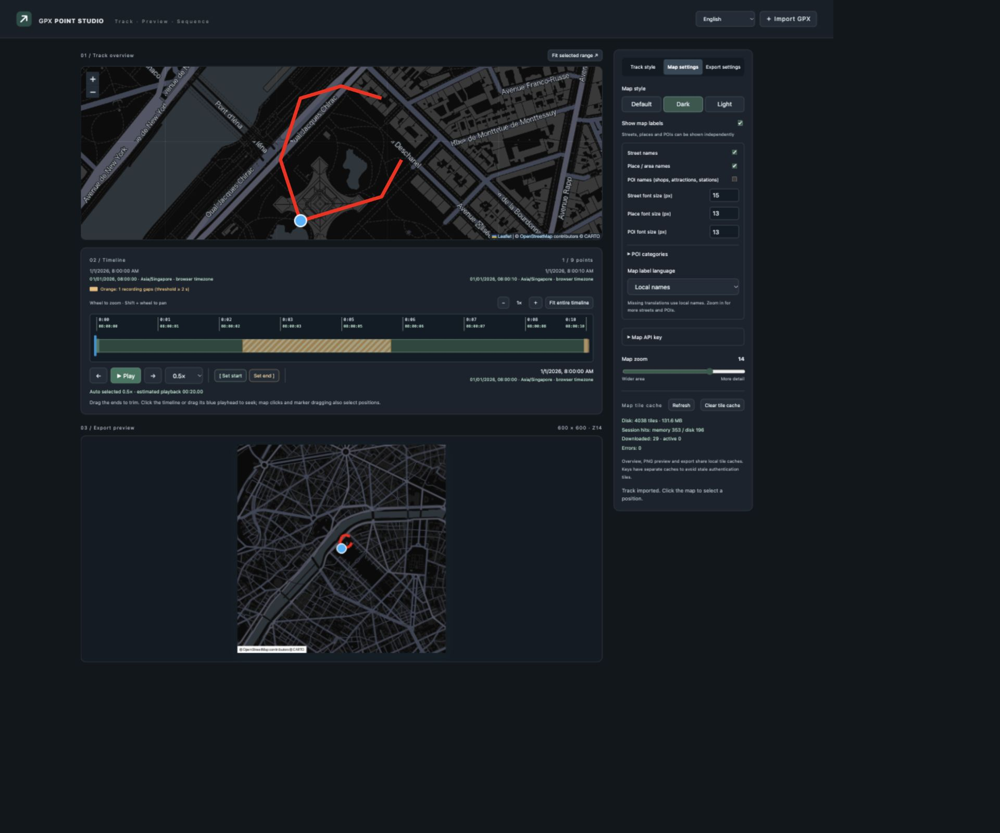
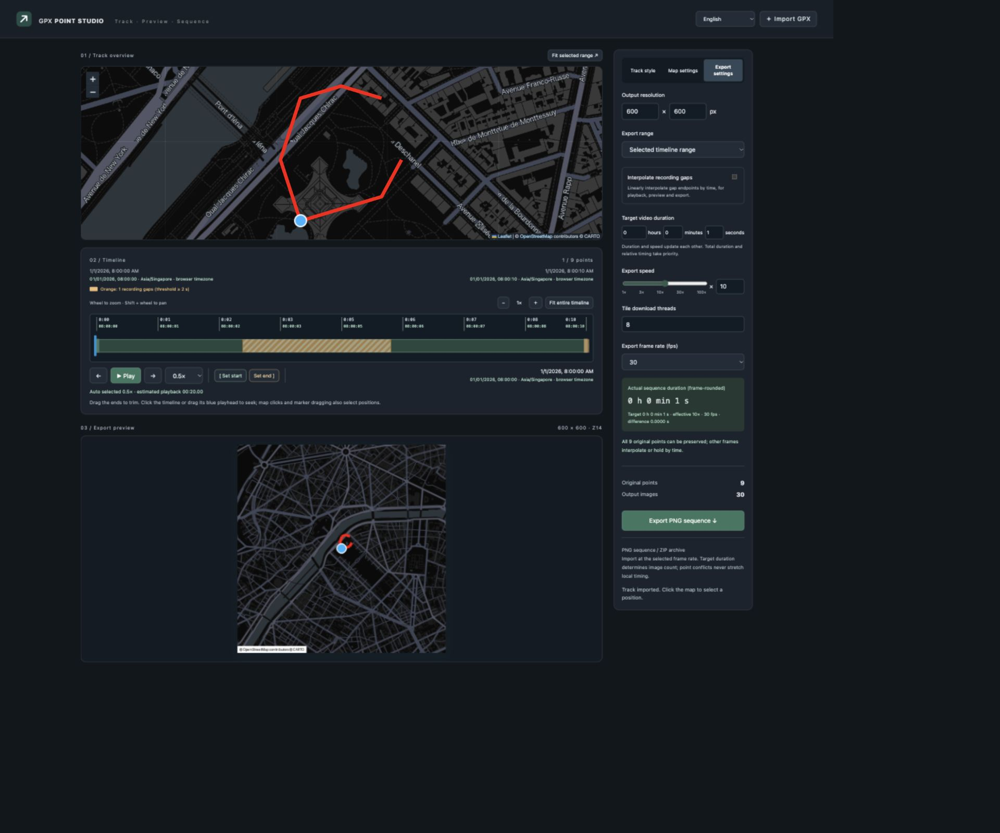

# GPX Point Studio

[简体中文](README.zh-CN.md)

Turn a GPX track into a map animation for your videos.
Preview the journey, choose the section you want, and export a PNG image sequence.



## 1. Start the app

Install Python 3.10 or later, then open a terminal in the project folder.

**macOS / Linux**

```sh
python3 -m venv .venv
.venv/bin/pip install -r requirements.txt
.venv/bin/python render_gpx_png_sequence.py
```

**Windows**

```powershell
python -m venv .venv
.venv\Scripts\pip install -r requirements.txt
.venv\Scripts\python render_gpx_png_sequence.py
```

Your browser opens at [127.0.0.1:8765](http://127.0.0.1:8765/).
Keep the terminal open while using the app. Press **Ctrl+C** there to stop it.

For later launches, run only the last command.
If the address is busy, append `--port 9000` and open the new address.

### Set up your map

The app starts with a dark interface and the **Dark** map.
Dark and Light maps need a CARTO API key.

1. Open **Map settings**.
2. Expand **Map API key**.
3. Enter your key and save it.

The same key is used for the overview, preview and export.
Choose **Default** to use the standard OpenStreetMap map without a CARTO key.

## 2. Import a track

Click **Import GPX**, or drop a `.gpx` file onto the page.
The overview automatically fits the route.

You can try [the demo GPX](examples/demo.gpx) first.
It contains an invented route, not a personal activity.
All screenshots in this guide use this demo.

Use the top-right selector to choose English, Simplified Chinese,
Traditional Chinese (Taiwan or Hong Kong), German or French.

## 3. Choose the section you want

- Click the timeline or drag the **blue playhead** to seek.
- Drag the left and right handles to trim the journey.
- Use **Set start** or **Set end** to place a boundary at the playhead.
- Use **+ / −** or the mouse wheel to zoom the timeline.
- Use **Shift + wheel** to move along the zoomed timeline.

The overview and exported images only draw the route inside these boundaries.
To export the whole trip, restore the handles to the beginning and end.

You can also click the map or drag the position marker to seek along the route.
Seeking on the timeline centers the overview on your current position.

Click **Play** to preview the journey.
Playback speed is separate from export speed.

### Recording gaps and times

Orange sections indicate unusually long recording gaps.
Turn on **Interpolate recording gaps** in Export settings to move smoothly
between their endpoints; those sections become blue.
Leave it off to hold the previous position through the gap.

Recorded times use an explicit non-Z timezone offset when supplied.
Otherwise, they are displayed in your browser's timezone.

## 4. Choose the appearance

Open the settings tabs on the right:

| Tab | What you can change |
| --- | --- |
| Track style | Route color and width; position marker size, color and outline |
| Map settings | Map style, zoom, label sizes and languages, POI categories |
| Export settings | Resolution, duration, speed, fps and gap interpolation |

The default route is red, 10px wide, with a 40px position marker and 6px white outline.
Street labels default to 15px; place and POI labels default to 13px.

POI labels are off by default.
Enable them to use the **32 category switches**, including transport,
shops, healthcare, parks and attractions. **Select all / Select none**
changes every category at once.

The default selected categories are public transport, government/civic services,
parks/nature and attractions/heritage.

Label options apply to **Dark / Light** maps.
Default map labels are embedded in the map and cannot be customized individually.
Available names depend on the map data; missing translations use local names.

The overview, PNG preview and export share your appearance settings.
Map zoom controls how much area each exported image shows.

## 5. Match your video and export



1. Open **Export settings** and choose the image width and height.
2. Enter your video's duration in **hours, minutes and seconds**.
3. Choose **25, 30, 50 or 60 fps**, matching your video project.
4. Check the calculated duration, image count and point-preservation message.
5. Click **Export PNG sequence**. On localhost, the app saves a timestamped folder
   and shows its path. On a remote domain, a ZIP streams directly to your browser.
6. Open the local folder (or extract the downloaded ZIP) and import the PNG files as an **image sequence**
   in your video editor, using the **same fps**.

You can enter an export speed instead of a target duration.
The last value you edit updates the other.
The speed slider gives finer control at low speeds; the number field
also accepts other positive speeds.

**Example:** a five-hour track fitted to a one-hour video uses **5×** speed.
At 30 fps it produces **108,000 images**.
Long recording intervals occupy proportionally more frames,
so you do not need to retime individual intervals in your editor.

If multiple original points fall into one output frame, the app reports it.
Increase fps or target duration to preserve more points.
The export keeps your chosen duration instead of stretching individual sections.

### Watch the progress

Downloads and rendering run together.
The page shows ready tiles, completed images, retries and ZIP packing.
You can adjust **Tile download threads** before exporting.

Failed tiles are deferred while other work continues, then retried.
Affected images are completed when their tiles become available.
Unavailable tiles and failed frames get up to 10 automatic attempts. After other work finishes, use Retry failed items to resume only incomplete work. Ready frames proceed immediately, keeping their original numbered filenames. Recovery is recorded in the log.

## Common questions

**The map is blank or reports an API key error.**
Check the key under Map settings, or try the Default map.
Also check your network connection.

**Labels did not update as expected.**
Changing font, language or POI options requests the matching map tiles.
Use **Clear tile cache** under Map settings to remove downloaded map data
and reload it. Wait for active downloads or export to finish before clearing.

**Will my key or GPX be committed to Git?**
Local keys, personal GPX files, cache and exports are ignored by Git.
The included demo GPX is synthetic.
Map providers receive requests for the map areas you view.

**Can I export one image per original GPS point?**
Use the command line:

```sh
.venv/bin/python render_gpx_png_sequence.py examples/demo.gpx png_sequence --zoom 14 --size 600x600 --map-style default
```

For a sequence that matches video timing, use the web interface instead.

The last numbered PNG is a separate attribution card, additional to the calculated journey frames. Hold it in the video credits long enough to read (for example, three seconds). Estimated journey duration excludes this extra image.

Local exports are saved under `.exports/<export-time>/` without creating or downloading a ZIP. Remote exports stream directly over HTTP without storing an output ZIP or temporary PNG files on the server. Tile caches are retained. The current-PNG button also saves locally when accessed through localhost.

After 10 unsuccessful attempts, Retry failed items resumes missing work; Skip failed frames finishes with those frames omitted. Original filenames are never renumbered. Skipped indices are listed in manifest.json. Error logs include HTTP status or connection details with credentials redacted.

Default output is 900×900 at zoom 15. Stop export from its progress dialog at any stage. Local images already written are kept; EXPORT_CANCELLED.json marks the incomplete export. Remote streaming stops without marking the result complete.
