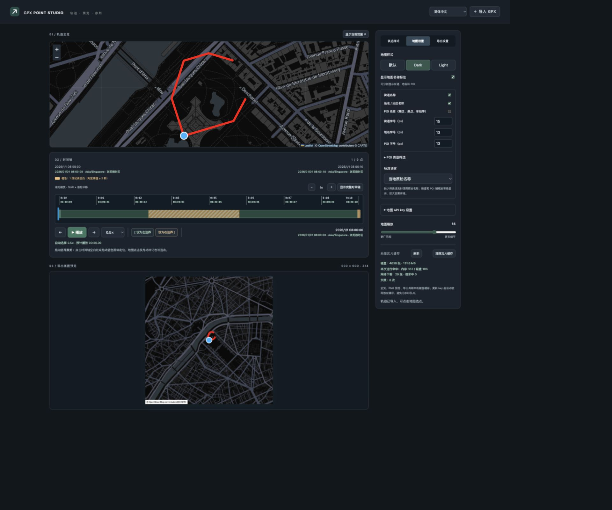
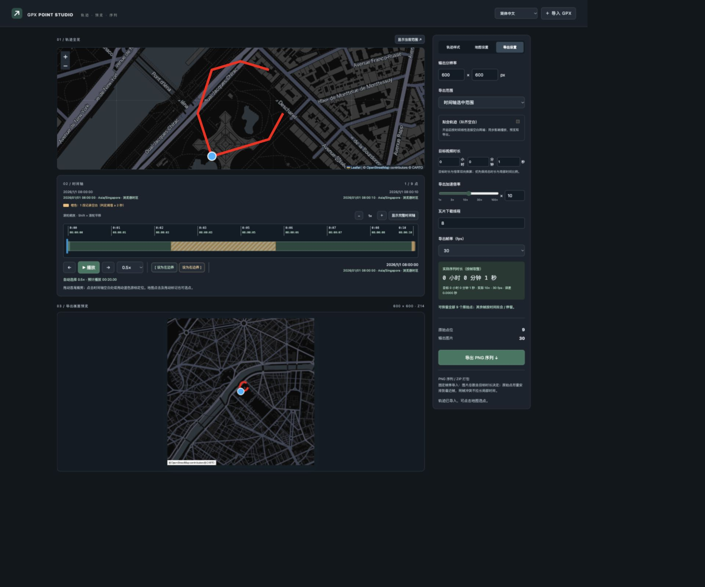

# GPX Point Studio

[English](README.md)

将 GPX 轨迹制作成地图动画，为视频配上同步的行程画面。
在网页中预览、裁剪和调整样式，最后导出 PNG 图片序列。



## 1. 启动软件

先安装 Python 3.10 或更高版本，在项目目录中打开终端。

**macOS / Linux**

```sh
python3 -m venv .venv
.venv/bin/pip install -r requirements.txt
.venv/bin/python render_gpx_png_sequence.py
```

**Windows**

```powershell
python -m venv .venv
.venv\Scripts\pip install -r requirements.txt
.venv\Scripts\python render_gpx_png_sequence.py
```

浏览器会自动打开 [127.0.0.1:8765](http://127.0.0.1:8765/)。
使用时保持终端开启，结束后在终端按 **Ctrl+C** 停止服务。

下次启动只需执行最后一条命令。
如果端口被占用，可在命令末尾加上 `--port 9000`，访问新的端口。

### 配置地图

页面和地图默认使用深色样式。
**Dark / Light** 地图需要 CARTO API key。

1. 打开右侧的「地图设置」。
2. 展开「地图 API key 设置」。
3. 输入 key 并保存。

全览、预览和导出会使用同一个 key。
没有 CARTO key 时，可以选择「默认」OpenStreetMap 地图。

## 2. 导入轨迹

点击右上角「导入 GPX」，或直接将 `.gpx` 文件拖入页面。
上方地图会自动缩放，展示整条轨迹。

首次使用可以导入 [演示 GPX](examples/demo.gpx)。
这是一条虚构轨迹，不含私人活动记录；文档截图也只使用这份示例。

右上角可以切换简体中文、繁体中文台湾、繁体中文香港、英文、德文和法文。
界面语言与地图标注语言分别设置。

## 3. 定位、预览与裁剪

- 点击时间轴，或拖动**蓝色游标**，选择当前位置。
- 拖动左右拉杆，设置行程的起止范围。
- 点击「设为左边界 / 设为右边界」，将边界设置到当前游标。
- 使用加减按钮或滚轮放大时间轴。
- 使用 **Shift + 滚轮**平移已放大的时间轴。

全览和导出图片只绘制左右边界内的轨迹。
需要完整行程时，将拉杆恢复到最左和最右即可。

也可以点击地图，或拖动当前位置标记沿轨迹定位。
通过时间轴定位时，全览会将当前位置放到中央。

点击「播放」即可预览。
播放倍率仅影响预览，不会改变导出倍率。

### 记录空白与录制时间

时间轴上的橙色区域表示较长的记录空白。
在「导出设置」开启「拟合轨迹」后，这些区域会变成蓝色，
并按照时间在两端之间平滑移动。
关闭拟合时，空白期间会停留在前一个点位。

GPX 明确记录非 Z 时区偏移时，按该偏移显示录制时间。
否则使用浏览器时区，不根据坐标或文件名推测。

## 4. 调整画面

右侧设置分为三个标签页：

| 标签页 | 可以调整的内容 |
| --- | --- |
| 轨迹样式 | 线条颜色与粗细，当前位置圆点的大小、颜色与描边 |
| 地图设置 | 地图样式、缩放、标注字号与语言、POI 分类 |
| 导出设置 | 分辨率、目标时长、倍率、帧率、空白拟合 |

默认轨迹线为红色、10px，当前位置圆点直径为 40px，白色描边 6px。
街道字号默认 15px，地名和 POI 字号默认 13px。

POI 名称默认关闭。
开启后，可在「POI 类型筛选」中独立选择 **32 类设施**，
或使用「全选 / 全不选」批量切换。

默认保留的四类是公共交通、政府与公共服务、
公园花园与自然、景点与历史遗迹。

标注分类、语言和字号适用于 **Dark / Light** 地图。
「默认」地图的名称嵌在底图中，无法单独调整。
名称是否存在取决于地图数据；缺少所选语言时会使用当地原名。

全览、PNG 预览与导出使用同一组样式。
地图缩放等级决定导出画面覆盖的地理范围。

## 5. 对齐视频并导出



1. 打开「导出设置」，填写图片的宽度和高度。
2. 在目标视频时长中填写**小时、分钟、秒**。
3. 选择 **25、30、50 或 60 fps**，与视频项目一致。
4. 检查预计时长、图片数量和原始点位保留提示。
5. 点击「导出 PNG 序列」。本机访问时直接保存到按时间命名的目录，并显示路径；
   非本机域名访问时，ZIP 会直接流式传输到浏览器。
6. 打开导出目录（远程下载时先解压 ZIP），在剪辑软件中按**图片序列**导入 PNG，
   并设置为导出时选择的**同一帧率**。

也可以直接修改导出倍率。
目标时长与倍率会双向换算，以最后修改的项目为准。
滑条在低倍率区域更容易微调，数值框支持输入其他正倍率。

**例如：**5 小时的轨迹匹配 1 小时视频，使用 **5×**。
30 fps 时会输出 **108,000 张**图片。
较长的记录间隔会占据更多帧，保持原有时间比例，
不需要在剪辑软件中逐段调整间隔。

如果多个原始点落入同一帧，页面会提示冲突。
提高帧率或延长目标时长，可以保留更多原始点。
系统优先保持目标总时长，不会单独拉长某段轨迹。

### 查看进度

下载瓦片和渲染会同时进行。
页面会显示瓦片就绪数、已完成图片、重试和 ZIP 打包阶段。
可在导出前调整「瓦片下载线程」。

失败瓦片会暂时跳过，先处理其他内容，再集中重试。
瓦片下载成功后，会补齐受影响的图片。
未就绪瓦片和失败帧最多自动尝试 10 次；其他任务完成后，可点击「重试失败项」继续补齐，已就绪帧先渲染，始终保留原编号；补下载及渲染恢复会写入日志。

## 常见问题

**地图空白或提示 API key 错误怎么办？**

在地图设置中检查 key，也可以切换为「默认」地图。
同时检查网络连接。

**切换标注参数后显示不正确怎么办？**

字号、语言和 POI 设置会使用对应参数的瓦片。
可以在地图设置中点击「清除瓦片缓存」，重新加载地图。
请等正在进行的瓦片下载或导出完成后再清理。

**私人轨迹和 key 会进入 Git 吗？**

本地 key、个人 GPX、缓存和导出文件已被 Git 忽略。
仓库中的演示 GPX 为合成数据。
地图提供方会收到所查看地区的瓦片请求。

**能否按每个原始点导出一张图？**

可以使用命令行：

```sh
.venv/bin/python render_gpx_png_sequence.py examples/demo.gpx png_sequence --zoom 14 --size 600x600 --map-style default
```

需要与视频时间同步时，请使用网页导出。

最后一张编号 PNG 为单独的来源署名图，位于轨迹帧之后。请在视频片尾将它延长至可读的时长（例如 3 秒）。预计轨迹时长不包含这张附加图片。

本机导出保存在 `.exports/导出时间/`，不生成 ZIP 或触发下载。远程导出通过 HTTP 流式传输，不在服务器保存输出 ZIP 或临时 PNG。地图瓦片缓存仍保留。本机的「渲染当前 PNG」也直接保存并显示路径。

自动尝试 10 次后，可选择「重试失败项」继续补齐，或「跳过失败帧」完成其余输出。原文件编号不重排，跳过编号记录在 manifest.json。错误日志显示 HTTP 状态或连接异常，并过滤凭据。

默认输出为 900×900、缩放等级 15。导出弹窗支持随时停止；本地已写出的图片保留，EXPORT_CANCELLED.json 标明未完成任务。远程流式传输停止后不会标记为完整导出。
