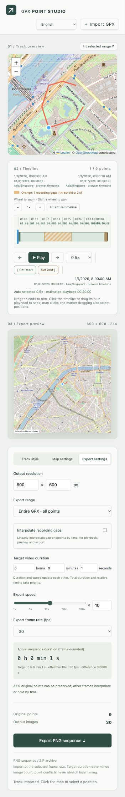

# 使用指南 / User guide

[README：安装、配置、命令行 / installation, configuration, CLI](../README.md)

## 导入 / Import

启动后打开 http://127.0.0.1:8765 。点击右上角导入 GPX，或将文件拖到页面。可先使用 [demo.gpx](../examples/demo.gpx)，这是虚构的演示轨迹，未包含私人活动。地图自动适配全部点位。

Start the server using the README instructions. Click **Import GPX** or drop a file onto the page. Try the invented demo above. The map automatically fits all points.

右上角可选择六种界面语言；地图设置中的标注语言单独配置。Default 地图的名称和语言由瓦片固定。

The top-right selector changes interface language; map label language is separate. Default map tiles have fixed labels.

## 时间轴 / Timeline

点击时间轴或拖动蓝色游标定位，全览会将当前位置居中。点击地图或拖动标记也可选点。拖动首尾拉杆裁剪，或用播放控件旁的左右边界按钮将边界设置到游标。全览隐藏范围外的轨迹。

Click the timeline or drag the blue playhead to seek and center the overview. Map clicks and marker dragging also seek. Drag the end handles, or use **Set start / Set end**, to trim. Only the selected route remains visible.

加减按钮或滚轮缩放时间轴，Shift+滚轮平移。播放倍率独立于导出倍率，自动选择约十分钟内播完的档位。

Use +/- or the wheel to zoom; Shift+wheel pans. Playback speed is independent of export speed and automatically targets a preview within about ten minutes.

空白阈值是正采样间隔中位数的两倍。关闭拟合时空白为橙色并停留在前一点；开启后变蓝并按时间线性连接。明确的非 Z 时区偏移会被保留，否则按浏览器时区显示，不推测录制地时区。

Gaps begin at twice the median positive recording interval. Orange gaps hold position; interpolation makes them blue and connects endpoints linearly. Explicit non-Z timezone offsets are respected; otherwise times use the browser timezone without guessing the recording location.

## 三个设置页 / Settings tabs

- **轨迹样式 / Track style**：线条颜色、宽度；当前位置直径、填充和描边 / line color and width; position diameter, fill and outline.
- **地图设置 / Map settings**：Default/Dark/Light、缩放、街道/地名/POI、标注语言、API key、缓存 / style, zoom, label categories and language, API key and cache.
- **导出设置 / Export settings**：分辨率、范围、拟合、目标时长、倍率和帧率 / resolution, range, interpolation, target duration, speed and fps.

全览、PNG 预览与导出共享样式和瓦片缓存。相同画面复用渲染内容，但最终仍有连续编号的完整 PNG 序列。缓存信息显示磁盘用量、命中、下载与错误。

Overview, preview and export share appearance and tile caches. Identical frames reuse rendering, while output retains every numbered PNG. Cache statistics show disk usage, hits, downloads and errors.

## 对齐视频并导出 / Match video and export

1. 填写视频的小时、分钟、秒，或设置倍率。最后编辑的一项驱动另一项。滑条为对数 1–100×，中点 10×，数值框支持其他正倍率。 / Enter target duration or speed; the last edited value drives the other. The slider is logarithmic, 1–100× with 10× at the midpoint.
2. 选择 25、30、50、60 fps，确认分辨率与导出范围。 / Choose fps, resolution and range.
3. 检查实际时长、帧数和点位冲突提示，点击导出。进度显示渲染/复用数量与剩余时间，完成后下载 ZIP。 / Review duration, frame count and conflicts, then export. Progress shows rendered/reused frames and remaining time. Download the completed ZIP.
4. 解压，在视频软件中以同一 fps 导入 PNG 图片序列。 / Extract and import the image sequence at the same fps in your editor.

例如 5 小时轨迹对齐 1 小时视频、30 fps：5×，108,000 张。各段时间比例保留，长间隔占据更多帧。原始点尽量安排到最近帧，同帧冲突不会拉长局部时间；可提高 fps 或延长时长，重复时间戳无法靠 fps 分离。manifest.json 记录设置及点位/帧映射。

Example: five hours of GPX matched to one hour at 30 fps produces 108,000 images at 5×. Relative timing is preserved. Original points use nearest frames; collisions never stretch local intervals. Raise fps or duration to reduce collisions. Equal timestamps cannot be separated by fps. manifest.json records settings and point/frame mappings.

## 数据与网络 / Data and network

真实 key 保留在本地 .env，页面不回传已保存的 key。不要覆盖已有 .env。它与缓存、导出、个人 GPX 均被 Git 忽略。唯一纳入版本控制的 GPX 是合成演示文件。

Keys stay in local .env and are not returned to the page. Do not overwrite an existing .env. Keys, caches, exports and personal GPX files are ignored by Git. Only the synthetic demo GPX is versioned.

GPX 在本机处理。地图提供方会收到所查看区域的瓦片请求，网页也会加载 Leaflet CDN。地图来源署名保留。截图只使用合成数据。

GPX processing runs locally. Map providers receive tile requests for viewed areas; the page also loads Leaflet from a CDN. Attribution remains visible. Screenshots use synthetic data only.
